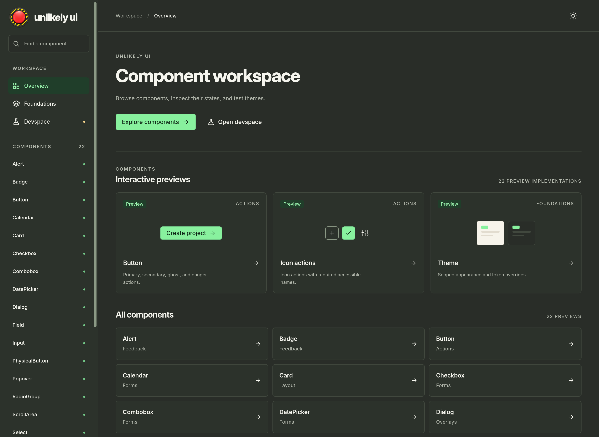

<p align="center">
  
</p>

<h1 align="center">unlikely ui</h1>

<p align="center">React components built on Base UI and Tailwind CSS v4.</p>

<p align="center">
  <a href="https://ui.kreoniz.ru">Playground and API reference</a> ·
  <a href="https://www.npmjs.com/package/unlikely-ui">npm</a> ·
  <a href="https://github.com/Kreoniz/unlikely-ui">Source</a>
</p>

[](https://ui.kreoniz.ru)

## Install

The unscoped package uses `next` for alpha releases. All components are previews.
Pin an exact version when installing or upgrading:

```sh
pnpm add -E unlikely-ui@0.1.0-alpha.3
```

Requires React and React DOM `^19.3.1` (fixtures use 19.3.1). ESM only.
The package ships JavaScript, TypeScript declarations and compiled CSS.

Alpha.3 adds Switch, Tabs, Menu, shadcn-style named parts and scoped semantic
utilities. Follow the installed [consumer guide](./USAGE.md) and
[component contracts](./docs/components.md) for your version. Review the
[upgrade guidance](./USAGE.md#upgrades-and-validation), especially Dialog's new
close-button default and the Combobox input/chip contracts. The showcase can
include newer checkout experiments; these are not package exports.

## Local development

The repo pins Node and pnpm with mise; `package.json` records the same pnpm version.

```sh
mise install
pnpm install --frozen-lockfile
pnpm dev
```

Open **http://127.0.0.1:5177** for the component workspace: overview, foundations,
interactive examples and a devspace for unfinished work. In a repository
checkout, see `docs/showcase.md` for adding components and experiments.
The App studies navigation opens two in-memory reference compositions at
`#apps/desk` and `#apps/settings`, with theme, language and content-state controls.

Preview components: `Alert`, `Badge`, `Button`, `Calendar`, `Card`, `Checkbox`,
`Combobox`, `DatePicker`, `Dialog`, `Field`, `Input`, `Menu`, `PhysicalButton`, `Popover`,
`RadioGroup`, `ScrollArea`, `Select`, `Skeleton`, `Spinner`, `Switch`, `Tabs`, `Textarea`, `Theme`, `Toast`, and
`Tooltip`. They have explicit package exports and isolated tarball consumer
checks. All components remain previews. See the [component contracts](./docs/components.md).
ScrollArea is included starting with `0.1.0-alpha.2`.

Alpha.3 adopts shadcn Base UI named-part conventions, standard
Button variants, `buttonVariants` and scoped semantic Tailwind utilities. It
keeps one implementation and compound compatibility aliases. Matching names do
not promise universal shadcn block compatibility or automatic upstream updates.

The mobile-friendly showcase includes Quick start, complete form recipes,
component examples and searchable API references generated from TypeScript.
It follows `main`; source and API links describe the checkout's availability.

Campus is a visual reference; its migration is separate.
See [release notes](./CHANGELOG.md) for the alpha's scope and limitations.

## Library usage

Read the [consumer guide](./USAGE.md) for setup, composition, themes and agent
usage. Contributor instructions belong to the repository's `AGENTS.md`.

Example for alpha.3:

```tsx
import { Theme } from 'unlikely-ui/theme';
import { Button } from 'unlikely-ui/button';
import 'unlikely-ui/styles.css';

<Theme appearance="dark">
  <Button>Create project</Button>
</Theme>;
```

React and React DOM are peers. Default styles are precompiled, so consumers do
not need Tailwind unless they author it themselves. The library adds no global
reset, font request or mascot asset. Apps using Tailwind should follow the
[layer/import recipe](./USAGE.md#tailwind-and-styling).

The repository's canonical `src/styles/tokens.css` feeds the runtime, generated
token-name types, foundations specification and review sheet.
`Theme` supports scoped appearance, direction and typed token overrides.
Nested themes inherit unspecified settings. Put an empty `Theme` inside a
custom portal to restore its originating React theme context. Use `tokens` for
overrides that must reach portals; ordinary `style` applies to that scope only.

## Checks and builds

```sh
pnpm check             # TypeScript and generated token types
pnpm docs:generate     # regenerate the showcase's typed API references
pnpm test:docs         # verify public types, defaults and inherited API extraction
pnpm test:scripts      # fixture ownership and startup failures
pnpm tokens:check      # regenerate sheet; palette contrast checks
pnpm build             # library ESM, types and CSS in dist/
pnpm showcase:build    # static workspace in .local/showcase/
pnpm test:browser      # gallery interactions, layout and accessibility checks
pnpm test:consumer     # packed artifact: types, SSR/hydration, CSS and portals
pnpm release:check     # complete pre-publication checks
```

The local consumer check installs from pnpm's cache offline and keeps
its package/fixture work under `.local/`. It verifies plain React and an
app-owned Tailwind build; CI uses prefer-offline installation for a fresh cache.
Browser prerequisites are in the repository's showcase guide.
Passing these checks is not a full accessibility audit or a claim of support
for every React framework.

## Documentation

The package includes the [consumer guide](./USAGE.md) and
[component contracts](./docs/components.md). They cover app integration and are
also the starting point for agents using the library.

Repository-only references:

- `AGENTS.md` — contributor instructions.
- `CONTEXT.md` — shared vocabulary.
- `docs/implementation.md` — milestones and layout.
- `docs/packaging.md` — npm first, source delivery possible later.
- `docs/showcase.md` — component catalogue and devspace workflow.
- `docs/releasing.md` — release checks and the separate npm publish step.
- `docs/foundations/tokens.md` — visual and token contract.

For uniform apps, keep shared foundations and styled controls in this package;
apps compose their own layouts and workflows. Own adapted shadcn source once
in the library, then distribute reviewed changes through package upgrades.
Registry delivery is optional future work using that same source; it is not
implemented. Release and visual compatibility policies are in the
[changelog](./CHANGELOG.md#release-policy).
Read [app styling and distribution guidance](./USAGE.md#keeping-multiple-apps-consistent).

## License

The package's code and documentation are [MIT licensed](./LICENSE).
Adapted shadcn/ui code retains its [MIT notice](./THIRD_PARTY_NOTICES.md).
The generated red button mascot, fonts, and retired artwork stay outside the
npm package and this software license grant. Their provenance and separate
terms are recorded in the repository's `docs/assets.md`. Runtime dependencies
retain their own licenses.
